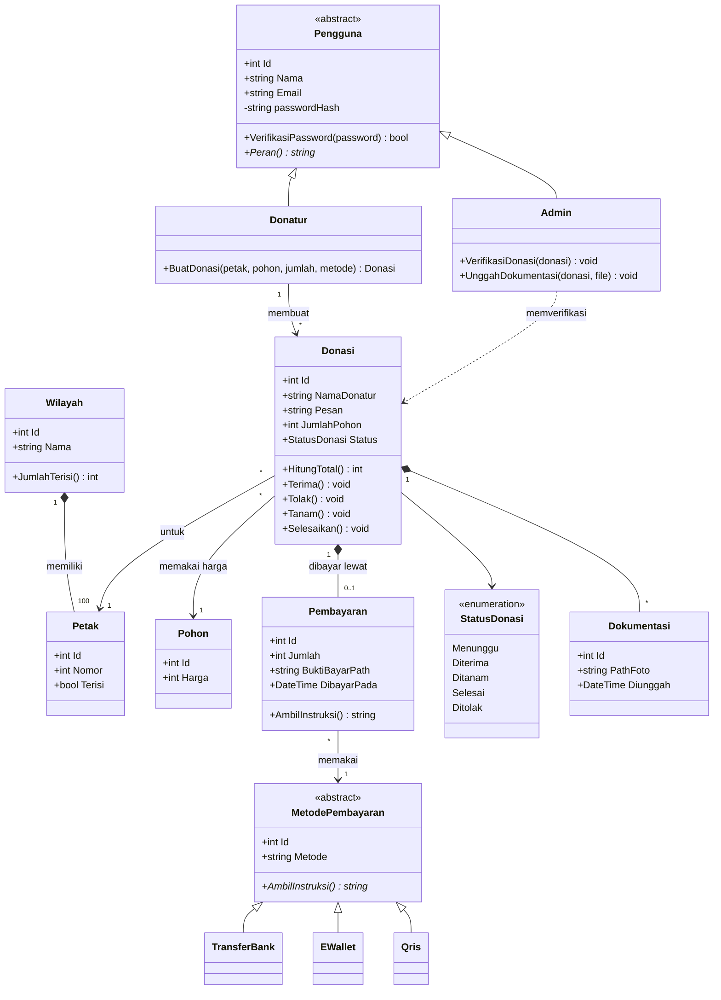
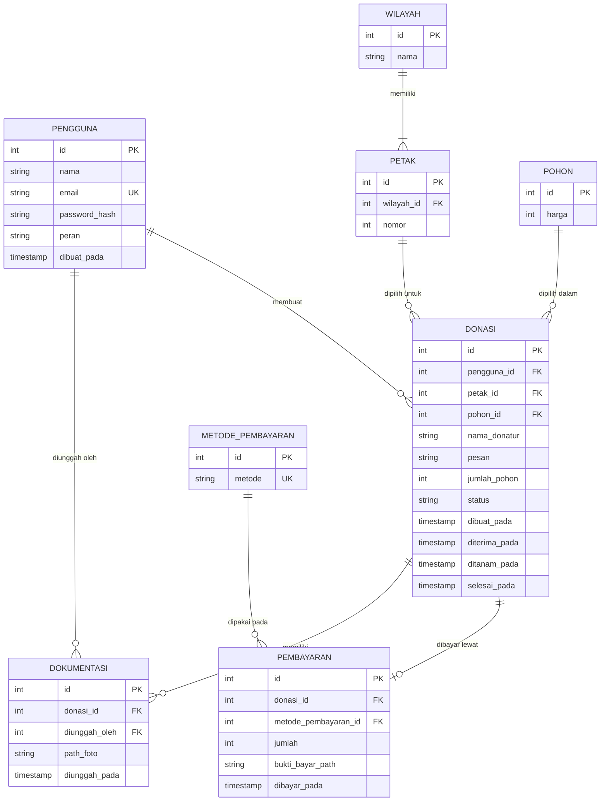
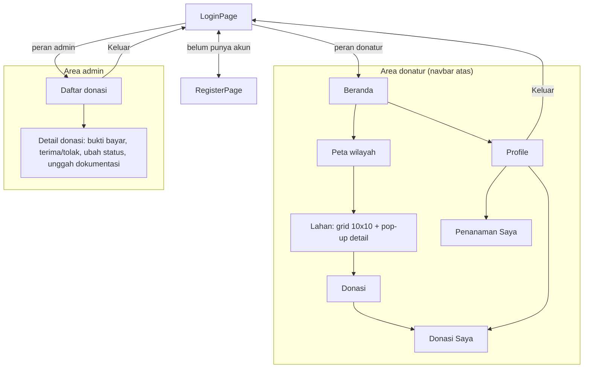

# Checkpoint — TERRAGENESIS (Proyek PBO, WinUI 3)

Dibuat: 19 November 2026. Diperbarui: 19 November 2026 sore (setelah LoginPage selesai dan repo GitHub dibuat).
Isi: ringkasan pembahasan sesi pertama.
Unggah file ini bersama `schema.sql` ke sesi berikutnya supaya konteksnya terbawa.

## 1. Tujuan dan lingkungan

- Tujuan: membuat aplikasi OOP (PBO) dengan antarmuka **WinUI 3**.
- Desain Figma: https://www.figma.com/design/HGco7zF20HmR3AXVUVJ1mf/PROJECT-PBO (file key `HGco7zF20HmR3AXVUVJ1mf`)
- Repo GitHub: https://github.com/DrinkingTracker/TERRAGENESISPBO. Commit awal baru berisi `.gitattributes`; commit file proyek (dan pengecekan `.gitignore`) belum dikonfirmasi.
- Visual Studio 2026 Community, workload **.NET desktop development** dan **WinUI application development** sudah terpasang.
- Proyek: **TERRAGENESIS (Package)**, konfigurasi Debug x64, disimpan di `D:\TERRAGENESIS\TERRAGENESIS`. Ini pertama kalinya memakai WinUI.
- Developer Mode Windows sudah diaktifkan. Deploy sempat gagal (`DEP0700 ... FAT32`) karena proyek ada di drive FAT32; setelah dipindah ke drive NTFS, aplikasi bisa jalan.
- Database: **PostgreSQL + pgAdmin** sudah terpasang.
- Metodologi: **SDLC waterfall**.

## 2. Konsep aplikasi (dibaca dari Figma)

Platform donasi penanaman pohon. Alur: pilih wilayah di peta → pilih petak kosong di grid 10x10 → isi donasi (jumlah pohon, nama, pesan, metode bayar, upload bukti) → admin verifikasi → penanaman → dokumentasi. Harga Rp 15.000 per pohon.

Layar di Figma: Beranda, Login, Peta wilayah, Lahan (grid + pop-up detail pohon), Donasi, Profile, Donasi Saya, Penanaman Saya. Layar **Register** dan **Admin** belum ada di Figma dan akan ditambahkan.

Catatan dari Figma:
- Peta Indonesia berupa vektor per provinsi, bagian tersulit di WinUI. Opsi: mulai dari kartu/tombol wilayah dulu, peta interaktif belakangan (belum diputuskan).
- Nama wilayah tidak seragam: kartu Beranda (Jawa Timur, Kalimantan, Sumatera Utara) vs label peta (Sumatra, Kalimantan, Sulawesi, Papua, Jawa Timur). Daftar final belum diputuskan.
- Ada angka tidak konsisten di desain (panel ringkasan 36 vs 37 petak terisi).
- Halaman Donasi menampilkan Jumlah Pohon 3 / Rp 45.000 dengan satu petak (#23). Ini sesuai keputusan: 1 donasi = 1 petak, banyak pohon.
- Frame Login di Figma: node `21:5` (1440×1024). Halaman lain (id frame): Beranda `1:7`, Peta wilayah `4:80`, Lahan `5:187` / `5:817`, Donasi `5:1090`, Profile `36:118`, Donasi Saya `44:263`, Penanaman Saya (di Figma bernama "Pesanan saya") `44:550`. Ada juga dua frame admin awal bernama "Pesanan saya" (`77:5`, `98:281`: Dashboard, Kelola Lahan, Kelola Donasi, Laporan) yang belum dibahas.
- Font di Figma: Metropolis Black / Black Italic (judul), Gotham Black dan Bold (tombol, paragraf), Plus Jakarta Sans Medium/Bold (isian form). Font itu belum terpasang di proyek.
- Warna halaman Login: hijau gelap `#25442B` (tombol), hijau `#317D3E` (logo/teks), `#0B3620` dan `#122F20` (judul), garis input `#6F9C76`, placeholder `#8DA196`, tautan `#3AAD30`.

## 3. Keputusan yang sudah ditetapkan

1. Login sungguhan dengan database, **ada halaman register**.
2. **Layar admin** akan ditambahkan (verifikasi donasi, ubah status, unggah dokumentasi).
3. Verifikasi pembayaran **manual** (upload bukti transfer).
4. **Satu donasi = satu petak, boleh banyak pohon**, tanpa batas pohon per petak.
5. Satu petak hanya bisa dipegang satu donasi aktif; donasi `ditolak` membebaskan petak.
6. Alur status donasi: menunggu → diterima → ditanam → selesai, atau menunggu → ditolak.
7. Password disimpan sebagai hash, query database memakai parameter.
8. Akun admin dibuat manual di database (tidak lewat register).
9. Penyimpanan: PostgreSQL via Npgsql (rencana; versi paket belum dicek).
10. **Revisi ERD 1:** `pohon`, `pembayaran`, dan `metode_pembayaran` menjadi tabel sendiri; tabel `pohon` hanya berisi `id` dan `harga` (diperlakukan sebagai katalog harga, bukan satu baris per pohon yang ditanam).
11. Kolom `kode` di `wilayah` dihapus; kolom nama di `metode_pembayaran` bernama `metode`; kolom waktu memakai `TIMESTAMP`.
12. Struktur kode: folder `Models`, `Repositories`, `Services`, `Pages`, `Controls`. Halaman memakai `Page` di dalam satu `Frame` pada `MainWindow`; Page hanya memanggil Services.
13. Gambar disimpan di `Assets/` per halaman (contoh `Assets/login/`).

## 4. Kebutuhan fungsional final (fase 1 selesai)

Donatur: register, login/logout, beranda, peta wilayah, lahan (grid petak), donasi, profile (+edit), donasi saya, penanaman saya.
Admin: lihat daftar donasi dan bukti bayar, terima/tolak, ubah status ke ditanam/selesai, unggah foto dokumentasi.

## 5. Status waterfall

| Fase | Status |
|---|---|
| 1. Analisis kebutuhan | Selesai |
| 2. Desain | Selesai (diagram kelas v2, ERD revisi 1, peta navigasi). ERD masih bisa direvisi lagi |
| 3. Implementasi | **Sedang berjalan**: proyek jalan, struktur folder dibuat, LoginPage (tampilan) selesai. Database, Models, Repository, Services belum |
| 4. Pengujian | Belum |
| 5. Deployment | Belum |
| 6. Pemeliharaan | Belum |

## 6. Diagram kelas (v2, lapisan Models)

Perubahan dari v1: ditambah `Pohon` dan `Pembayaran`; `MetodePembayaran` kini dipegang `Pembayaran` (bukan `Donasi`); `Wilayah.Kode` dihapus; `Donasi.Total` menjadi method `HitungTotal()` (= `JumlahPohon × Pohon.Harga`, nilainya disalin ke `Pembayaran.Jumlah` saat donasi dibuat).

Pemetaan 4 pilar OOP:
- **Encapsulation**: `passwordHash` private; `Donasi.Status` hanya berubah lewat `Terima/Tolak/Tanam/Selesaikan` dengan aturan urutan; `Petak.Terisi` tidak bisa diubah sembarangan.
- **Inheritance**: `Pengguna` → `Donatur`, `Admin`.
- **Polymorphism**: `MetodePembayaran` → `TransferBank`, `EWallet`, `Qris` (override `AmbilInstruksi()`). Di database hanya ada tabel `metode_pembayaran` (id, metode); kelas konkretnya dipilih dari nama metode saat data dibaca (misalnya lewat factory sederhana, belum diputuskan).
- **Abstraction**: kelas abstract `Pengguna`, `MetodePembayaran`, dan interface Repository.

Lapisan lain (usulan, belum digambar):
- Repositories: `IPenggunaRepository`, `IWilayahRepository` (termasuk petak), `IDonasiRepository` (termasuk pembayaran dan dokumentasi), plus satu repository untuk data referensi (`pohon`, `metode_pembayaran`); implementasi `Pg...Repository` (Npgsql).
- Services: `AuthService` (register/login/hash), `LahanService`, `DonasiService`.
- Pages WinUI hanya memanggil Services; tidak ada SQL di code-behind.

## 7. ERD (revisi 1)

Catatan ERD:
- Aturan "satu petak satu donasi aktif" diterapkan lewat partial unique index `uq_donasi_petak_aktif` (`WHERE status <> 'ditolak'`) di `schema.sql`; tidak terlihat di diagram.
- Satu donasi punya paling banyak satu pembayaran (`pembayaran.donasi_id` UNIQUE).
- `pembayaran.jumlah` menyimpan nominal yang dibayar saat itu, sehingga riwayat tidak berubah bila `pohon.harga` diganti. Bisa dihapus bila ingin tanpa data ganda (total dihitung dari `jumlah_pohon × pohon.harga`).
- `peran` dan `status` berupa teks dengan `CHECK`.
- Status verifikasi tetap di `donasi.status`, bukan di `pembayaran`.
- `schema.sql` (8 tabel + data awal: 3 wilayah, 300 petak, harga pohon 15000, 3 metode bayar) **belum diuji di PostgreSQL**. Versi buatan pengguna sempat punya koma berlebih di tabel `pohon` (syntax error) dan `id` tanpa `IDENTITY`; versi di `schema.sql` sudah memperbaikinya (pengembalian `IDENTITY` menunggu konfirmasi pengguna).

## 8. Peta navigasi halaman

Navbar atas membuat Beranda, Lahan, Donasi, dan Profile bisa dibuka langsung dari halaman mana pun di area donatur.

## 9. Progres implementasi

Struktur proyek (di dalam proyek TERRAGENESIS): `Models`, `Repositories`, `Services`, `Pages`, `Controls`, `Assets`. `MainPage.xaml` bawaan template masih ada dan belum dihapus.

- `MainWindow`: hanya berisi `Frame` bernama `RootFrame`, yang membuka `LoginPage` saat aplikasi mulai.
- `Pages/LoginPage.xaml` dan `.xaml.cs`: **tampilan selesai, tanpa database**. Dirancang di kanvas 1440×1024 (ukuran frame Figma) di dalam `Viewbox`, dengan latar foto penuh. Fitur: ikon mata untuk menampilkan password, checkbox "Ingat Saya", tautan "Lupa Password?" dan "Daftar Sekarang" (keduanya baru menampilkan pesan sementara), validasi kolom kosong. Logika login sungguhan (`AuthService`) belum ada.
- Aset di `Assets/login/`: `LoginBackground.jpeg`, `leaf.png`, `padlock.png`, `user.png` (milik pengguna); `logo.png`, `logo-watermark.png`, `eye.png`, `eye-off.png`, `login-arrow.png` (**placeholder buatan Claude**, harus diganti aset asli dari Figma). `sample login.png` hanya acuan, jangan disertakan ke proyek.
- Font sementara: Segoe UI / Segoe UI Black lewat tiga resource `FontBlack`, `FontBold`, `FontIsi` di bagian atas `LoginPage.xaml`. Ganti di situ bila font Metropolis, Gotham, dan Plus Jakarta Sans sudah dipasang.
- Belum diterapkan dari Figma: bayangan teks, bayangan kartu, blur 2px pada daun.
- Posisi elemen kiri dihitung dari screenshot Figma, belum diukur di aplikasi; sesuaikan lewat `Canvas.Left/Top` bila bergeser.

## 10. Pertanyaan terbuka dan hal yang akan direvisi

1. Konfirmasi: `id` tabel memakai `IDENTITY` (otomatis) atau diisi manual?
2. Revisi ERD lanjutan oleh pengguna (nama/jumlah wilayah, `dokumentasi` per donasi atau per petak, perlu kolom `instruksi` di `metode_pembayaran` atau hardcode di kelas).
3. `Petak.Terisi` bergantung pada ada tidaknya donasi aktif: setuju? (belum dijawab)
4. Cara membuat peta Indonesia interaktif di WinUI.
5. Dosen/tugas memiliki format dokumen atau syarat OOP tertentu? (belum dijawab)
6. Apakah commit proyek sudah berhasil di-push ke GitHub, dan apakah `.gitignore` sudah ada (jangan sampai `bin`/`obj` ikut)?
7. Apakah font Figma tersedia (file .ttf) untuk dipasang?
8. Frame admin di Figma bernama "Pesanan saya" (`77:5`, `98:281`) tampaknya awal desain layar admin; belum dibahas dan perlu dicocokkan dengan kebutuhan admin.

## 11. Langkah berikutnya

1. Commit semua file proyek dan push ke GitHub (cek `.gitignore` dulu).
2. Jalankan `schema.sql` di database `terragenesis` dan cek tabel `petak` berisi 300 baris.
3. Halaman berikutnya sesuai Figma: Register (belum ada di Figma), lalu Beranda dan `NavbarControl` (dipakai ulang di banyak halaman).
4. Tambah Npgsql lewat NuGet, buat Models, Repository, Services, lalu hubungkan login ke database (`AuthService`).
5. Ganti aset placeholder dan pasang font asli.
