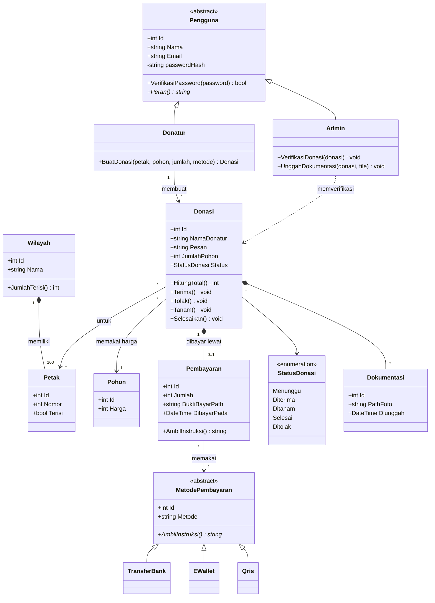
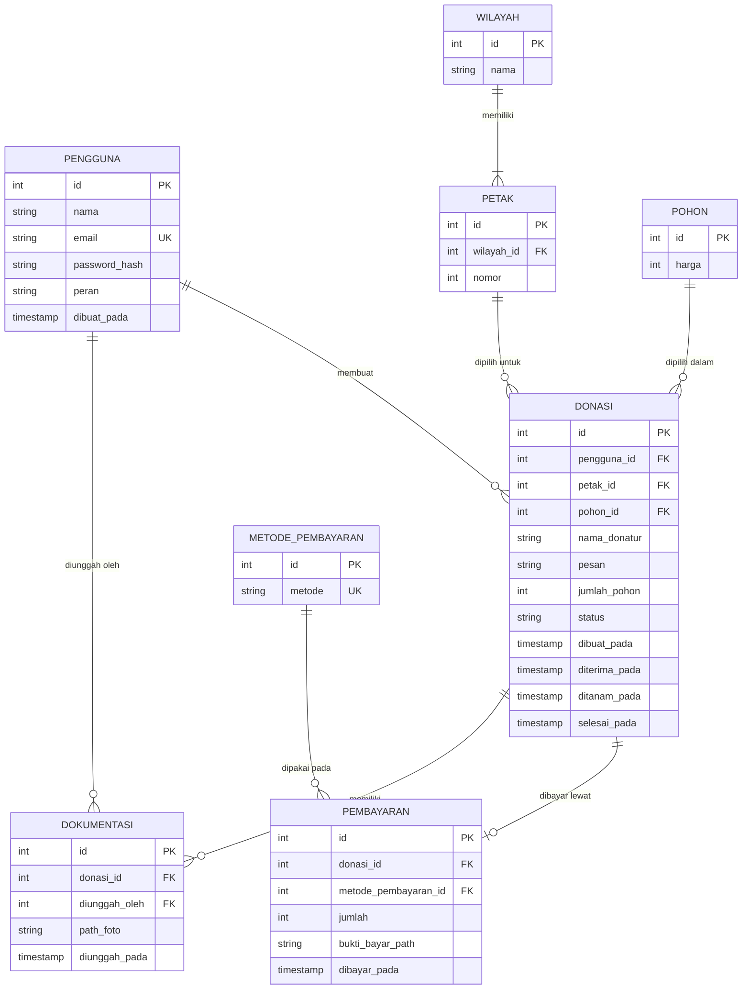
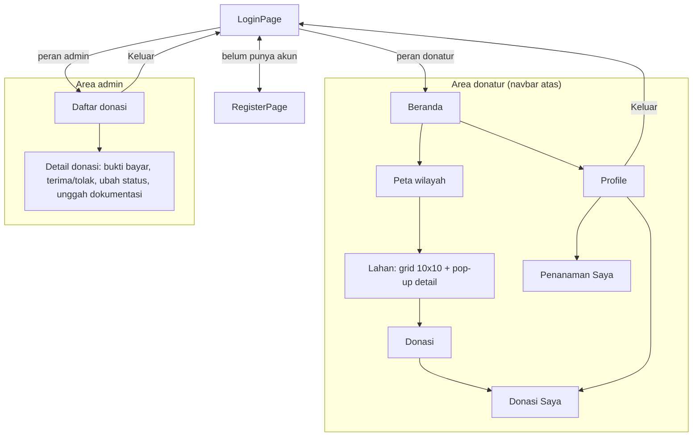

# Checkpoint — TERRAGENESIS (Proyek PBO, WinUI 3)

Dibuat: 19 November 2026. Diperbarui: 19 November 2026 malam (setelah Figma di-fetch ulang, BerandaPage + NavbarControl + LahanCard dibuat, dan error bayangan diperbaiki).
Isi: ringkasan pembahasan sampai sesi ini, menggantikan `checkpoint 3.md`.
Unggah file ini bersama `schema.sql` ke sesi berikutnya supaya konteksnya terbawa.

## 1. Tujuan dan lingkungan

- Tujuan: membuat aplikasi OOP (PBO) dengan antarmuka **WinUI 3**.
- Desain Figma: https://www.figma.com/design/HGco7zF20HmR3AXVUVJ1mf/PROJECT-PBO (file key `HGco7zF20HmR3AXVUVJ1mf`)
- Repo GitHub: https://github.com/DrinkingTracker/TERRAGENESISPBO. Commit awal baru berisi `.gitattributes`; commit file proyek (dan pengecekan `.gitignore`) belum dikonfirmasi.
- Visual Studio 2026 Community, workload **.NET desktop development** dan **WinUI application development** sudah terpasang.
- Proyek: **TERRAGENESIS (Package)**, konfigurasi Debug x64, disimpan di `D:\TERRAGENESIS\TERRAGENESIS`. Ini pertama kalinya memakai WinUI.
- Developer Mode Windows sudah diaktifkan. Deploy sempat gagal (`DEP0700 ... FAT32`) karena proyek ada di drive FAT32; setelah dipindah ke drive NTFS, aplikasi bisa jalan.
- Database: **PostgreSQL + pgAdmin** sudah terpasang.
- Metodologi: **SDLC waterfall**.
- Catatan kerja: shell Claude tidak bisa mengunduh dari figma.com (akses diblokir), jadi aset gambar diekspor sendiri oleh pengguna dari Figma. Kode diberikan sebagai file terpisah (bukan zip), pengguna menaruhnya sendiri ke folder proyek.

## 2. Konsep aplikasi (dibaca dari Figma)

Platform donasi penanaman pohon. Alur: pilih wilayah di peta → pilih petak kosong di grid 10x10 → isi donasi (jumlah pohon, nama, pesan, metode bayar, upload bukti) → admin verifikasi → penanaman → dokumentasi. Harga Rp 15.000 per pohon.

Layar donatur di Figma: Beranda, Login, Peta wilayah, Lahan (grid + pop-up detail pohon), Donasi, Profile, Donasi Saya, Penanaman Saya. Layar **Register** belum ada di Figma dan akan ditambahkan.

Catatan dari Figma:
- Peta Indonesia berupa vektor per provinsi, bagian tersulit di WinUI. Opsi: mulai dari kartu/tombol wilayah dulu, peta interaktif belakangan (belum diputuskan).
- Nama wilayah tidak seragam: kartu Beranda (Jawa Timur, Kalimantan, Sumatera Utara) vs label peta (Sumatra, Kalimantan, Sulawesi, Papua, Jawa Timur). Daftar final belum diputuskan.
- Ada angka tidak konsisten di desain (panel ringkasan 36 vs 37 petak terisi; statistik Beranda 128.450 pohon / +10 RB donatur / +10 wilayah bersifat contoh, berbeda dari Dashboard Admin).
- Halaman Donasi menampilkan Jumlah Pohon 3 / Rp 45.000 dengan satu petak (#23). Ini sesuai keputusan: 1 donasi = 1 petak, banyak pohon.
- Id frame donatur: Beranda `1:7`, Login `21:5` (1440×1024), Peta wilayah `4:80`, Lahan `5:187` / `5:817`, Donasi `5:1090`, Profile `36:118`, Donasi Saya `44:263`, Penanaman Saya (di Figma bernama "Pesanan saya") `44:550`.
- Font di Figma: Metropolis Black / Black Italic (judul, logo), Gotham Black dan Bold (judul, tombol), Plus Jakarta Sans Medium/ExtraBold/Bold (menu, angka, isian form). Belum terpasang di proyek.
- Warna Login: hijau gelap `#25442B` (tombol), hijau `#317D3E` (logo/teks), `#0B3620` dan `#122F20` (judul), garis input `#6F9C76`, placeholder `#8DA196`, tautan `#3AAD30`.
- Warna Beranda: tombol `#3A7232`, judul `#122F20`, aksen "Kehidupan" `#48D53B`, angka statistik `#10352A`, keterangan `#5F7A6D`, lencana slot `#C9EFCF`.

### Pembaruan Figma yang ditemukan sesi ini (layar admin sudah ada)

Frame admin berada di bawah halaman donatur (sidebar: Dashboard, Kelola Lahan, Kelola Donasi, Riwayat Penanaman, Laporan, Keluar):
- **Dashboard Admin** `77:5` ("Ringkasan Laporan Sistem"): kartu Total Pohon Ditanam 78, Lahan Tersedia 464, Total Donasi Rp 45.000, Total Pengguna 37; panel Peta Wilayah; panel "Aktivitas Baru" (contoh: "Penanaman pohon di petak #23", 16 November 2026, status Proses).
- **Kelola Lahan** `98:281`: kolom pencarian "Cari petak lahan...", tabel Lahan / Wilayah / Status (contoh "Aktif") / Aksi (lihat, ubah, hapus), "Menampilkan 1-10 dari 500 data" + paginasi. Menyiratkan admin bisa mengelola petak (CRUD) dan petak punya status aktif/nonaktif.
- **Kelola Donasi** `110:732`: pencarian nama donatur, tabel Nama Donatur / Jumlah / Total Biaya / Bukti Bayar (gambar) / Aksi (centang = setujui, silang = tolak); status di desain bertuliskan **"Disetujui"**, sedangkan alur status di checkpoint adalah "diterima".
- **Riwayat Penanaman** `115:1202`: tabel Tanggal / Wilayah / Lahan / Jumlah pohon; satu baris tanggal tampak memuat beberapa petak.
- **Laporan**: menu ada di sidebar, framenya belum terbaca.

Catatan: hasil metadata Figma sempat terpotong, jadi halaman donatur lain (Donasi, Peta, Lahan, Profile) **belum dibaca ulang**; yang dibaca detail hanya Beranda dan struktur frame admin. ERD dan diagram kelas **belum diubah** untuk menampung temuan di atas.

### Desain Beranda (frame `1:7`, 1440×1024)

Navbar (logo + "TERRAGENESIS", menu Beranda / Lahan / Donasi / Profile, foto profil), hero berlatar hutan (judul "Satu Pilihan, Tumbuhkan Kehidupan", paragraf, tombol "Jelajahi Lahan"), kartu statistik (Total Pohon Tertanam, Donatur Peduli, Wilayah terhijaukan), judul "Lahan Unggulan", tiga kartu wilayah: Jawa Timur (12 slot), Kalimantan (8 slot), Sumatera Utara (10 slot).

## 3. Keputusan yang sudah ditetapkan

1. Login sungguhan dengan database, **ada halaman register**.
2. **Layar admin** (verifikasi donasi, ubah status, unggah dokumentasi); desain Figma-nya kini sudah ada (lihat bagian 2).
3. Verifikasi pembayaran **manual** (upload bukti transfer).
4. **Satu donasi = satu petak, boleh banyak pohon**, tanpa batas pohon per petak.
5. Satu petak hanya bisa dipegang satu donasi aktif; donasi `ditolak` membebaskan petak.
6. Alur status donasi: menunggu → diterima → ditanam → selesai, atau menunggu → ditolak.
7. Password disimpan sebagai hash, query database memakai parameter.
8. Akun admin dibuat manual di database (tidak lewat register).
9. Penyimpanan: PostgreSQL via Npgsql (rencana; versi paket belum dicek).
10. **Revisi ERD 1:** `pohon`, `pembayaran`, dan `metode_pembayaran` menjadi tabel sendiri; tabel `pohon` hanya berisi `id` dan `harga` (katalog harga, bukan satu baris per pohon yang ditanam).
11. Kolom `kode` di `wilayah` dihapus; kolom nama di `metode_pembayaran` bernama `metode`; kolom waktu memakai `TIMESTAMP`.
12. Struktur kode: folder `Models`, `Repositories`, `Services`, `Pages`, `Controls`. Halaman memakai `Page` di dalam satu `Frame` pada `MainWindow`; Page hanya memanggil Services.
13. Gambar disimpan di `Assets/` per halaman (contoh `Assets/login/`, `Assets/beranda/`).
14. **Urutan kerja:** kerjakan dulu bagian yang tidak banyak memengaruhi hal lain (UI halaman tanpa database) sebelum merevisi ERD dan diagram kelas.
15. **Peran folder `Controls`:** komponen UI yang dipakai ulang di banyak halaman (`UserControl`), tanpa pengetahuan soal halaman lain atau database; berkomunikasi lewat properti dan event. `Pages` = layar utuh.

## 4. Kebutuhan fungsional final (fase 1 selesai)

Donatur: register, login/logout, beranda, peta wilayah, lahan (grid petak), donasi, profile (+edit), donasi saya, penanaman saya.
Admin: lihat daftar donasi dan bukti bayar, terima/tolak, ubah status ke ditanam/selesai, unggah foto dokumentasi. (Dari Figma terbaru, kemungkinan bertambah: dashboard/laporan, kelola petak, riwayat penanaman; belum diputuskan masuk lingkup.)

## 5. Status waterfall

| Fase | Status |
|---|---|
| 1. Analisis kebutuhan | Selesai |
| 2. Desain | Selesai (diagram kelas v2, ERD revisi 1, peta navigasi). Akan direvisi lagi mengikuti pembaruan Figma (layar admin) |
| 3. Implementasi | **Sedang berjalan**: LoginPage dan BerandaPage (tampilan) selesai. Database, Models, Repository, Services belum |
| 4. Pengujian | Belum |
| 5. Deployment | Belum |
| 6. Pemeliharaan | Belum |

## 6. Diagram kelas (v2, lapisan Models)

Perubahan dari v1: ditambah `Pohon` dan `Pembayaran`; `MetodePembayaran` kini dipegang `Pembayaran` (bukan `Donasi`); `Wilayah.Kode` dihapus; `Donasi.Total` menjadi method `HitungTotal()` (= `JumlahPohon × Pohon.Harga`, nilainya disalin ke `Pembayaran.Jumlah` saat donasi dibuat).

Pemetaan 4 pilar OOP:
- **Encapsulation**: `passwordHash` private; `Donasi.Status` hanya berubah lewat `Terima/Tolak/Tanam/Selesaikan` dengan aturan urutan; `Petak.Terisi` tidak bisa diubah sembarangan. Di lapisan UI: `NavbarControl` dan `LahanCard` hanya terbuka lewat properti dan event.
- **Inheritance**: `Pengguna` → `Donatur`, `Admin`.
- **Polymorphism**: `MetodePembayaran` → `TransferBank`, `EWallet`, `Qris` (override `AmbilInstruksi()`). Di database hanya ada tabel `metode_pembayaran` (id, metode); kelas konkretnya dipilih dari nama metode saat data dibaca (misalnya lewat factory sederhana, belum diputuskan).
- **Abstraction**: kelas abstract `Pengguna`, `MetodePembayaran`, dan interface Repository.

Lapisan lain (usulan, belum digambar):
- Repositories: `IPenggunaRepository`, `IWilayahRepository` (termasuk petak), `IDonasiRepository` (termasuk pembayaran dan dokumentasi), plus satu repository untuk data referensi (`pohon`, `metode_pembayaran`); implementasi `Pg...Repository` (Npgsql).
- Services: `AuthService` (register/login/hash), `LahanService`, `DonasiService`.
- Pages WinUI hanya memanggil Services; tidak ada SQL di code-behind.

## 7. ERD (revisi 1)

Catatan ERD:
- Aturan "satu petak satu donasi aktif" diterapkan lewat partial unique index `uq_donasi_petak_aktif` (`WHERE status <> 'ditolak'`) di `schema.sql`; tidak terlihat di diagram.
- Satu donasi punya paling banyak satu pembayaran (`pembayaran.donasi_id` UNIQUE).
- `pembayaran.jumlah` menyimpan nominal yang dibayar saat itu, sehingga riwayat tidak berubah bila `pohon.harga` diganti. Bisa dihapus bila ingin tanpa data ganda (total dihitung dari `jumlah_pohon × pohon.harga`).
- `peran` dan `status` berupa teks dengan `CHECK`.
- Status verifikasi tetap di `donasi.status`, bukan di `pembayaran`.
- `schema.sql` (8 tabel + data awal: 3 wilayah, 300 petak, harga pohon 15000, 3 metode bayar) **belum diuji di PostgreSQL**. Versi buatan pengguna sempat punya koma berlebih di tabel `pohon` (syntax error) dan `id` tanpa `IDENTITY`; versi di `schema.sql` sudah memperbaikinya (pengembalian `IDENTITY` menunggu konfirmasi pengguna).

## 8. Peta navigasi halaman

Navbar atas membuat Beranda, Lahan, Donasi, dan Profile bisa dibuka langsung dari halaman mana pun di area donatur. Peta ini perlu diperbarui: area admin di Figma kini punya Dashboard, Kelola Lahan, Kelola Donasi, Riwayat Penanaman, Laporan (bukan hanya "Daftar donasi").

## 9. Progres implementasi

Struktur proyek (di dalam proyek TERRAGENESIS): `Models`, `Repositories`, `Services`, `Pages`, `Controls`, `Assets`. `MainPage.xaml` bawaan template masih ada dan belum dihapus.

**Login**
- `MainWindow`: hanya berisi `Frame` bernama `RootFrame`, yang membuka `LoginPage` saat aplikasi mulai.
- `Pages/LoginPage.xaml` dan `.xaml.cs`: tampilan selesai, tanpa database. Kanvas 1440×1024 di dalam `Viewbox`. Fitur: ikon mata untuk password, checkbox "Ingat Saya", tautan "Lupa Password?" dan "Daftar Sekarang" (baru pesan sementara), validasi kolom kosong. `AuthService` belum ada.
- Aset `Assets/login/`: `LoginBackground.jpeg`, `leaf.png`, `padlock.png`, `user.png` (milik pengguna); `logo.png`, `logo-watermark.png`, `eye.png`, `eye-off.png`, `login-arrow.png` (**placeholder buatan Claude**, harus diganti aset asli dari Figma).
- Font sementara: Segoe UI / Segoe UI Black lewat resource `FontBlack`, `FontBold`, `FontIsi` di bagian atas `LoginPage.xaml`.
- Belum diterapkan dari Figma: bayangan teks, bayangan kartu, blur 2px pada daun. Posisi elemen kiri belum diukur di aplikasi.

**Beranda (sesi ini, tampilan saja, data masih hardcode)**
- `Controls/NavbarControl.xaml` + `.cs`: navbar atas. Properti `ActivePage` (garis bawah menu aktif), event `NavigateRequested` (membawa "Beranda" / "Lahan" / "Donasi" / "Profile").
- `Controls/LahanCard.xaml` + `.cs`: kartu wilayah. Properti `Judul`, `JumlahSlot`, `Gambar`; event `Dipilih`; method `PasangReceiver(UIElement)` untuk bayangan.
- `Pages/BerandaPage.xaml` + `.cs`: kanvas 1440×1024 dalam `Viewbox`. Menu navbar, tombol "Jelajahi Lahan", dan kartu wilayah baru menampilkan dialog "Halaman belum dibuat". Angka statistik diisi tetap lewat `TxtTotalPohon`, `TxtDonatur`, `TxtWilayah`.
- Namespace yang dipakai: `TERRAGENESIS`, `TERRAGENESIS.Controls`, `TERRAGENESIS.Pages` (diasumsikan; belum dikonfirmasi sesuai proyek).
- Aset di `D:\TERRAGENESIS\TERRAGENESIS\Assets\beranda` (diekspor pengguna dari Figma): `daun.png`, `donatur.png`, `Frame 9.png` (hero, ekspor datar; di XAML ditulis `Frame%209.png`), `jawatimur.png`, `kalimantan.png`, `pohon.png`, `profile.png`, `sumaterautara.png`, `pin.png` (ditambahkan pengguna belakangan; `LahanCard.xaml` sudah dikembalikan memakai `Image` pin.png). `sampel beranda.png` hanya acuan, jangan disertakan ke proyek.
- `logo.png` (layer Logo 1, node `2:3`, 80×80) sudah ditambahkan pengguna ke `Assets/beranda`.
- Hal yang belum persis Figma: font sementara; warna garis bawah menu `#3A7232` hanya perkiraan; panah tombol digambar ulang dengan `Path` (bukan SVG asli); bayangan memakai `ThemeShadow`; posisi pin/judul kartu disamakan (di Figma bergeser 1 sampai 4 px antar kartu).
- **Bug yang ditemukan dan diperbaiki:** saat F5, `ThemeShadow.Receivers.Add(...)` melempar `ArgumentException: The parameter is incorrect` dari konstruktor `BerandaPage`. Perbaikan: pemasangan bayangan dipindah ke event `Loaded` dan dibungkus `try/catch (ArgumentException)`. Penyebab dugaan (elemen belum masuk visual tree), belum terbukti pasti; pengguna mengonfirmasi setelah perbaikan dan penambahan `logo.png` bahwa semuanya sudah beres (detail tampilan bayangan tidak dirinci).
- Cara mencoba halaman: sementara ubah `RootFrame.Navigate(typeof(Pages.LoginPage))` di `MainWindow.xaml.cs` menjadi `typeof(Pages.BerandaPage)`, lalu F5 (Debug, x64). Untuk alur Login → Beranda: `Frame.Navigate(typeof(TERRAGENESIS.Pages.BerandaPage));` di tombol Masuk (belum dikonfirmasi sudah dipasang).

## 10. Pertanyaan terbuka dan hal yang akan direvisi

1. Konfirmasi: `id` tabel memakai `IDENTITY` (otomatis) atau diisi manual?
2. Revisi ERD dan diagram kelas mengikuti Figma terbaru: status donasi "Disetujui" vs "diterima"; apakah petak punya status aktif/nonaktif dan admin boleh ubah/hapus petak; riwayat penanaman dengan banyak petak per baris (bertentangan dengan 1 donasi = 1 petak?); apakah ada tabel/laporan tambahan; nama/jumlah wilayah; `dokumentasi` per donasi atau per petak; kolom `instruksi` di `metode_pembayaran` atau hardcode di kelas.
3. `Petak.Terisi` bergantung pada ada tidaknya donasi aktif: setuju? (belum dijawab)
4. Cara membuat peta Indonesia interaktif di WinUI.
5. Dosen/tugas memiliki format dokumen atau syarat OOP tertentu? (belum dijawab)
6. Apakah commit proyek sudah berhasil di-push ke GitHub, dan apakah `.gitignore` sudah ada (jangan sampai `bin`/`obj` ikut)?
7. Apakah font Figma tersedia (file .ttf) untuk dipasang?
8. Bagaimana nama wilayah final (Beranda: Jawa Timur, Kalimantan, Sumatera Utara; peta: Sumatra, Kalimantan, Sulawesi, Papua, Jawa Timur)?

## 11. Langkah berikutnya

1. Commit semua file proyek dan push ke GitHub (cek `.gitignore` dulu).
2. Halaman berikutnya yang tidak memengaruhi bagian lain: RegisterPage (belum ada di Figma, ikuti gaya LoginPage) atau Peta wilayah (mulai dari kartu/tombol wilayah).
3. Baca ulang sisa frame Figma (Donasi, Peta, Lahan, Profile, Laporan), lalu revisi ERD dan diagram kelas bersama.
4. Jalankan `schema.sql` di database `terragenesis` dan cek tabel `petak` berisi 300 baris.
5. Tambah Npgsql lewat NuGet, buat Models, Repository, Services, lalu hubungkan login ke database (`AuthService`).
6. Ganti aset placeholder login dan pasang font asli.
